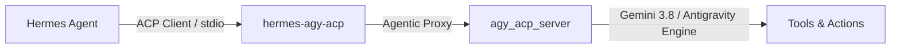

# hermes-agy-acp

Decoupled Agent Client Protocol (ACP) adapter bridging [NousResearch Hermes Agent](https://github.com/NousResearch/Hermes-Agent) with Google Antigravity.

---

## Overview

`hermes-agy-acp` enables Hermes Agent to interface seamlessly with Google Antigravity's autonomous agent engine over the Agent Client Protocol (ACP). It acts as a specialized model-provider plugin, resolving the agentic "Split-Brain" dilemma by operating in `agentic_proxy` mode where tool execution is delegated natively to Antigravity.



## Key Features

- **12-Factor Configuration**: Zero hardcoded paths; dynamic cross-platform discovery via `shutil.which` supporting Linux `.par` and Windows `.cmd` binaries.
- **Split-Brain Elimination**: Native `agentic_proxy` middleware strips duplicate Hermes tool manifests to avoid cognitive collision with Antigravity native tools.
- **Auto-Approval Permission Broker**: Transparent non-blocking handling of `session/request_permission` payloads.
- **Persistent SQLite Session Registry**: Maps `hermes_session_id <-> acp_session_id` in `$HERMES_HOME/state_agy_acp.db` with strict `0600` permissions and `/reset` handling.
- **Autonomous Skill Learning Pipeline**: Hooks into Hermes `background_review` and `curator` routines, synthesizing procedural procedures via `agy` on Gemini 3.8 Flash High and synchronizing validated skills to `~/.gemini/config/skills/`.
- **Cleanroom Blind TDD Architecture**: Designed and tested under rigorous dual-user privilege separation (`h` vs `testu`).

## Installation

```bash
git clone https://github.com/SpIvanM/hermes-agy-acp.git
cd hermes-agy-acp
pip install -e .
```

To install as a Hermes user plugin:
```bash
mkdir -p ~/.hermes/plugins
cp -r . ~/.hermes/plugins/hermes-agy-acp
```

## Configuration

Copy `.env.example` to `.env` and configure environment variables as needed:

| Variable | Default | Description |
|---|---|---|
| `AGY_CLI_PATH` | Auto-detected | Path to `agy` CLI binary |
| `AGY_ACP_SERVER_PATH` | Auto-detected | Path to `agy_acp_server` binary |
| `AGY_ACP_ARGS` | `--uid=` (Linux) | Execution flags passed to ACP server |
| `AGY_DEFAULT_MODEL` | `gemini-3.8-flash-high` | Default model for session prompts |
| `AGY_THINKING_LEVEL` | `high` | Reasoning / thinking budget (`low`, `medium`, `high`, `off`) |
| `AGY_LOG_LEVEL` | `warn` | Diagnostic log level (`error`, `warn`, `info`, `debug`) |
| `AGY_MODE` | `agentic_proxy` | Operating mode (`agentic_proxy` or `direct`) |
| `AGY_STATE_DB_PATH` | `~/.hermes/state_agy_acp.db` | SQLite persistent session database path |

## Diagnostic Commands

In Hermes chat or CLI sessions:
- `/agy status` — Displays binary discovery, session metrics, and process health.
- `/agy reset` — Clears ACP session mapping and initiates clean session state.

## License

MIT License. See [LICENSE](LICENSE) for details.
