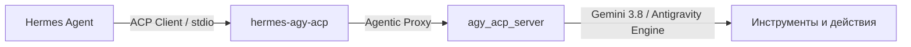

# hermes-agy-acp (Русская документация)

Развязанный адаптер протокола Agent Client Protocol (ACP), соединяющий [NousResearch Hermes Agent](https://github.com/NousResearch/Hermes-Agent) с платформой Google Antigravity.

---

## Обзор

`hermes-agy-acp` позволяет агенту Hermes прозрачно взаимодействовать с автономным агентным движком Google Antigravity по протоколу ACP. Проект функционирует как плагин класса `model-provider`, устраняя проблему расщепления внимания ("Split-Brain") за счет режима `agentic_proxy`, в котором оркестрация инструментов делегируется Antigravity.



## Ключевые возможности

- **Конфигурация 12-Factor**: Полное отсутствие жестко закодированных путей. Динамический поиск бинарников через `shutil.which` с поддержкой Linux `.par` и Windows `.cmd`.
- **Устранение Split-Brain**: Промежуточное ПО `agentic_proxy` автоматически удаляет дублирующие схемы инструментов Hermes, предотвращая конфликты с нативными инструментами Antigravity.
- **Неблокирующий брокер разрешений**: Автоматическое согласование запросов прав доступа `session/request_permission`.
- **Постоянный реестр сессий SQLite**: Сохранение связей `hermes_session_id <-> acp_session_id` в `$HERMES_HOME/state_agy_acp.db` с правами доступа `0600` и поддержкой команды `/reset`.
- **Автономное обучение навыкам**: Интеграция с хуками Hermes `background_review` и `curator`, синтез процедурных навыков через `agy` на базе Gemini 3.8 Flash High и синхронизация в `~/.gemini/config/skills/`.
- **Разработка по методологии Cleanroom Blind TDD**: Полная изоляция привилегий разработчика (`h`) и тестировщика (`testu`).

## Установка

```bash
git clone https://github.com/SpIvanM/hermes-agy-acp.git
cd hermes-agy-acp
pip install -e .
```

Установка в качестве пользовательского плагина Hermes:
```bash
mkdir -p ~/.hermes/plugins
cp -r . ~/.hermes/plugins/hermes-agy-acp
```

## Конфигурация

Скопируйте `.env.example` в `.env` и настройте переменные окружения:

| Переменная | По умолчанию | Описание |
|---|---|---|
| `AGY_CLI_PATH` | Автоопределение | Путь к исполняемому файлу `agy` |
| `AGY_ACP_SERVER_PATH` | Автоопределение | Путь к серверу `agy_acp_server` |
| `AGY_ACP_ARGS` | `--uid=` (Linux) | Аргументы запуска сервера ACP |
| `AGY_DEFAULT_MODEL` | `gemini-3.8-flash-high` | Модель по умолчанию |
| `AGY_THINKING_LEVEL` | `high` | Уровень рассуждений (`low`, `medium`, `high`, `off`) |
| `AGY_LOG_LEVEL` | `warn` | Уровень логирования (`error`, `warn`, `info`, `debug`) |
| `AGY_MODE` | `agentic_proxy` | Режим работы (`agentic_proxy` или `direct`) |
| `AGY_STATE_DB_PATH` | `~/.hermes/state_agy_acp.db` | Путь к БД реестра сессий SQLite |

## Диагностические команды

В чате Hermes или интерфейсе CLI:
- `/agy status` — Проверка доступности бинарников, активных сессий и состояния сервера.
- `/agy reset` — Сброс привязки текущей сессии ACP.

## Лицензия

MIT License. См. файл [LICENSE](LICENSE).
